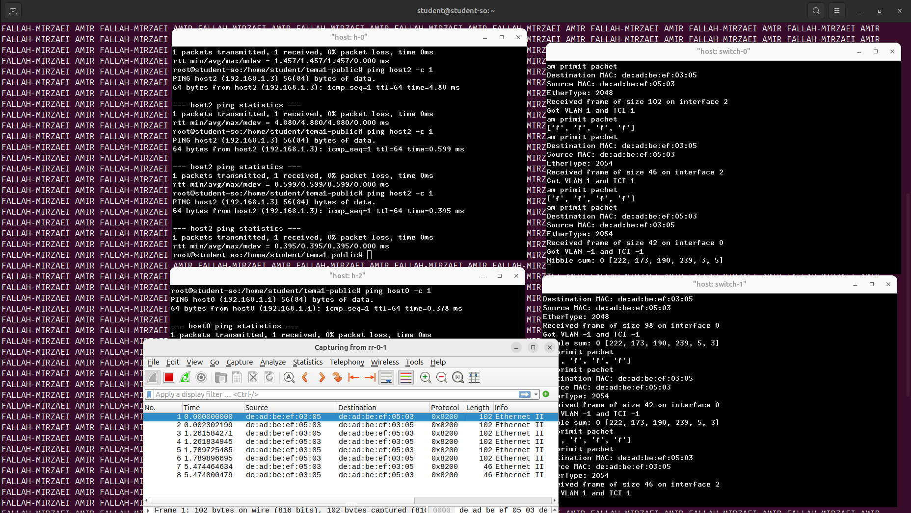
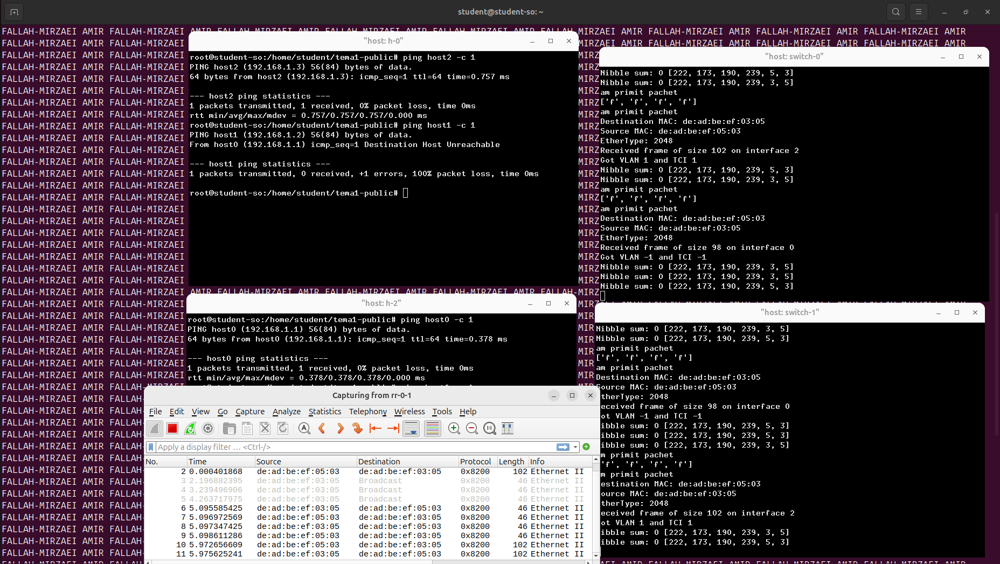
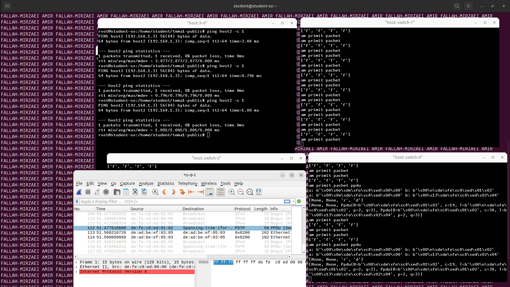

# Tema 1 RL: Switch

*cerinte rezolvate: 1, 2, 3*

## Learning

Am reprezentat tabela CAM sub forma unui dictionar (hashmap), folosind
algoritmul dat in enunt, dar simplificat. In loc sa verific daca andresa mac
destinatie este unicast si apoi separat daca aceasta este prezenta in tabela
CAM, verific doar daca adresa destinatie este in tabela sau nu. In plus cand
fac adaugarile in tabela CAM am grija sa inserez doar adrese mac unicast.

### Exemplu

Host0 poate sa comunice cu Host2 asta inseamna ca:

- frame-urile sunt trimise in retea
- switch-urile nu fac broadcast la fiecare cadru, adica tabelele CAM
  functioneaza si retin adresele sursa 

**RUTA:** H0 --- SW0 --- SW1 --- H2 **RUTA:** H2 --- SW1 --- H3

## VLAN

La acest exercitiu am fost nevoit sa parsez datele de configurare pentru
switch-uri. De aici am extras tipul de port pentru fiecare interfata
(access/trunk), date pe care le stochez intr-o lista pe fiecare router. In rest
singurele reguli care se adauga, modifica functionalitatea de broadcast unde
verificam daca sursa si destinatia au acelasi **VLAN_ID**. Verificarea
*nibble-ului* se face doar daca adresa destinatie este in tabela CAM.

Initial nu am facut aceasta verificare a *nibble-ului* si am avut conectivitate
intre mai multe dispozitive decat trebuie. Acest *nibble* mi se pare o problema
deoarece, transmiterea corecta a acestuia tine de fiecare host in parte, deci
el poate fi schimbat si reprezinta o vulnerabilitate. Ca eficientizare a
algoritmului putem elimina acest nibble care reprezinta o vulnerabilitate.

### Exemplu

 

**RUTA:** H0 -1- SW0 -T- SW1 -1- H2  **RUTA:** H0 -1- SW0 -T- SW1 -1- H3 
**RUTA:** H0 -1- SW0 -2- H1

Host0 poate sa comunice cu Host2 dar nu cu Host3 din cauza *nibble-ului* care
nu este egal, chiar daca toate trei statiile apartin aceluiasi VLAN. Host0 nu
poate comunica cu Host1 pentru ca sunt in VLAN-uri diferite.

## STP

Pentru STP am creat doua threaduri: unul trimite mesaje HPDU, celalat mesaje
PPDU, ambele la interval de o secunda. Initial toate switch-urile sunt
root-bridge si trimit mesaje PPDU. Daca primesc un mesaj PPDU cu RBID (root
bridge id) mai mic, ele se opresc din a mai transmite PPDU si doar fac forward
la mesajele primite de la noul RBID. Intr-un vector pastram pentru fiecare
interfata mesajul PPDU cu costul cel mai mic provenit de la RBID sub forma
**<R, c, T, p, q>**, unde:

- R = BID-ul root-bridge-ului care a generat mesajul
- c = costul de la R la nodul curent
- T = BID-ul ultimei statii care a avut mesajul inainte sa ajunga la switch-ul
  curent
- p = interfata pe care T a trimis mesajul
- q = interfata pe care swith-ul curent a primit mesajul

Aplicam algoritmul si populam vectorul de porturi:

- c este minim => interfata este de tip *root-port*
- T > BID switch => interfata este *designated-port*
- T < BID switch => interfata este *blocked-port*

Daca acest pas s-a terminat cu succes, schimbam intrarile din vectorul
PORT\_MODES din *"b"* in *"f"* semnificand ca porturile au trecut din Blocking
in Forwarding.

O optimizare a algoritmului ar fi: detectarea interfetelor la care nu sunt
conecatate switch-uri prin primirea de HPDU sau PPDU de pe acea interfata.

### Exemplu

La pornirea tuturor celor 3 switch-uri observam ca nu se creeaza o bucla de
cadre, iar pachetele ICMP trimise intre statii nu genereaza  flooding.

## Referinte

Pentru valorile din header-ul PPDU am folosit urmatoarele surse:

https://beta.computer-networking.info/syllabus/default/protocols/lan.html?highlight=spanning%20tree%20protocol#the-spanning-tree-protocol-802-1d

- de aici am preluat modul de stocare a PPDU-urilor si initial costul pentru
  legatura de 100Mbps = 2e6

https://ocw.cs.pub.ro/courses/_media/rl/courses/rl05-optimizare-lan-25-26.pdf

- din curs am preluat corect costul legaturii de 100Mbps = 19

https://www.quora.com/What-is-the-multicast-address-used-in-STP

- de pe acest site am preluat adresa destinatie pentru PPDU 01:80:c2:00:00:00

https://picture.iczhiku.com/resource/eetop/SyiGpsFWqELwKVnM.pdf

*pagina 153, sectiunea 17.14, tabelul 17.1 - "RSTP Timer and Transmit Hold Count
parameter values", randul 2 - "Bridge Hello Time (17.13.6)", coloana 2*: 2.0
secunde - valoarea recomandata pentru Hello Time 

*pagina 153, sectiunea 17.14, tabelul 17.1 - "RSTP Timer and Transmit Hold Count
parameter values", randul 2 - "Bridge Max Age (17.13.8)", coloana 3*: 40.0
secunde - valoarea maxima pentru Max Age

*pagina 153, sectiunea 17.14, tabelul 17.1 - "RSTP Timer and Transmit Hold Count
parameter values", randul 2 - "Bridge Forward Delay (17.13.5)", coloana 2*: 4.0
secunde - valoarea minima pentru Forward Delay

Includ si acest paragram de pe pagina 153, sectiunea 17.14, imediat dupa tabelul 17.1, in care se specifica faptul ca timpii pentru STP sunt identici ca cei pentru RSTP:

"*The recommended values for Bridge Hello Time, Bridge Max Age, and Bridge Forward Delay are the same
as those specified for STP in previous revisions of this standard. They have
been retained to facilitate interoperability and integration of RSTP Bridges
into networks that include legacy STP Bridges, to support migration of existing
networks to RSTP.*"

https://en.wikipedia.org/wiki/Spanning\_Tree\_Protocol

- Configuration, Path to the root bridge, subpunctul 4, a doua bulina: formula pentru port id
